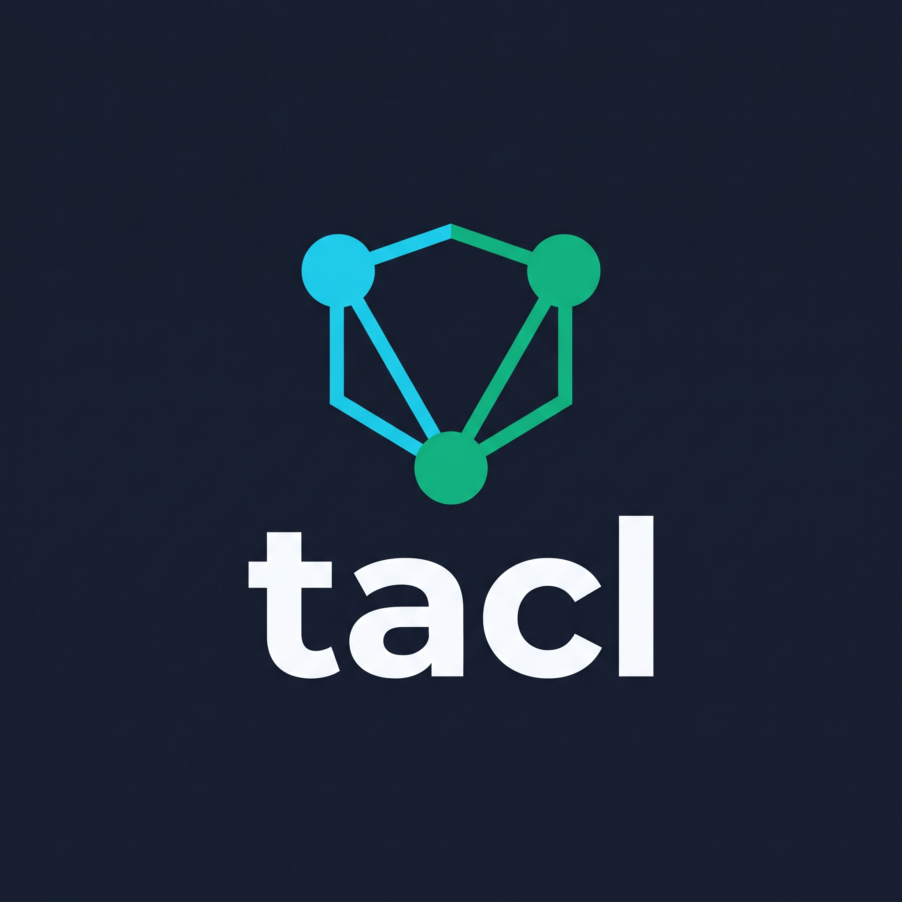
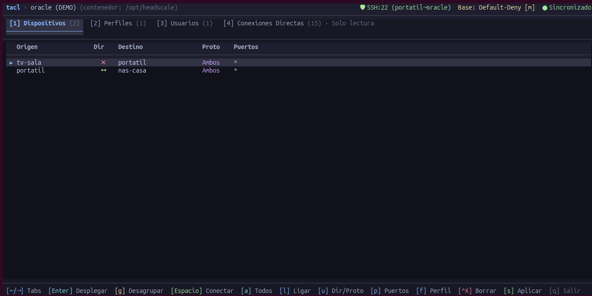
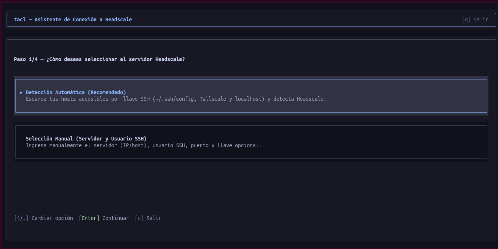
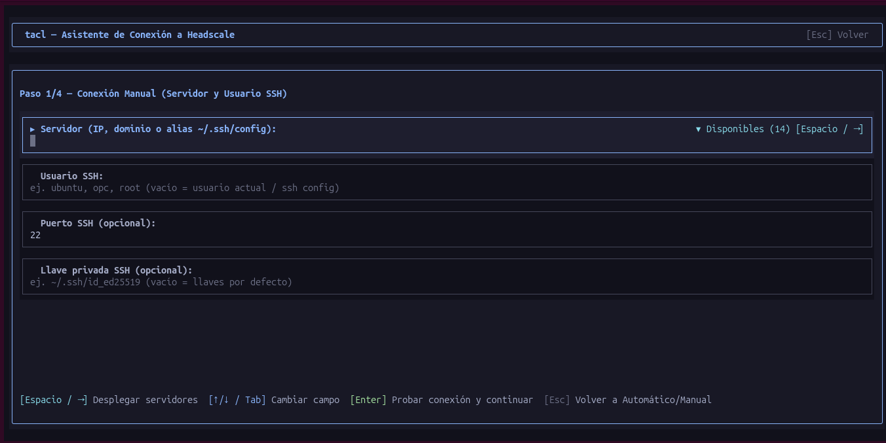
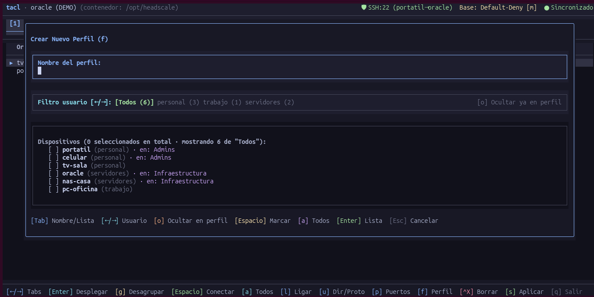
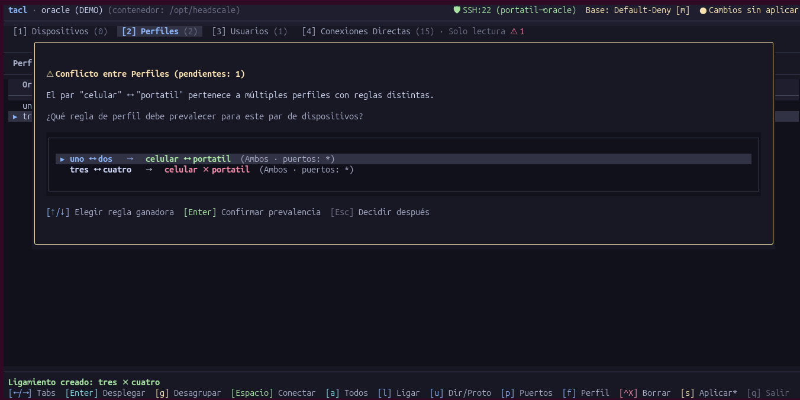
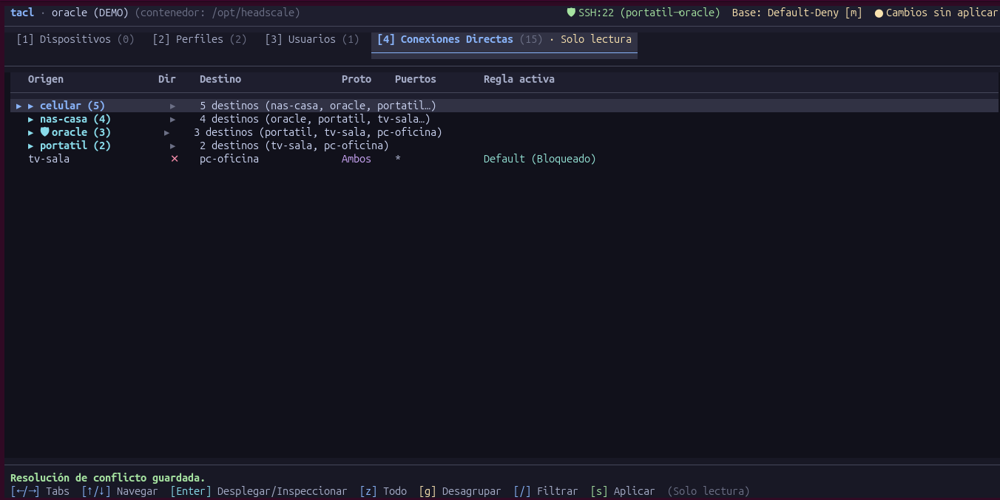
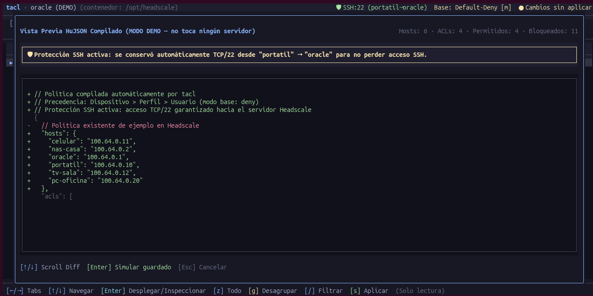

<p align="center">
  
</p>

<h1 align="center">tacl</h1>

<p align="center">
  <strong>TUI interactiva para administrar ACLs de Headscale con precedencia <code>Dispositivo &gt; Perfil &gt; Usuario</code></strong>
</p>

---

**`tacl`** es una interfaz de terminal interactiva (**TUI**) construida con **TypeScript, Bun y OpenTUI** para administrar visualmente las políticas de acceso (**ACLs**) de **Headscale**.

En lugar de editar manualmente extensos archivos **HuJSON**, `tacl` te permite gestionar la conectividad de tu red mediante un modelo jerárquico claro (**`Dispositivo > Perfil > Usuario > Default`**), detectar conflictos automáticamente, proteger tu enlace SSH administrativo y compilar políticas HuJSON válidas con vista previa (*diff*) y respaldos automáticos.



---

## Características principales

- **Modelo jerárquico de precedencia:** evalúa reglas en orden estricto `Dispositivo > Perfil > Usuario > Política base`.
- **Perfiles propios de `tacl`:** agrupa dispositivos libremente (un mismo dispositivo puede pertenecer a varios perfiles) con **resolución interactiva de conflictos** cuando dos perfiles se contradicen.
- **Protección automática de conexión SSH (`🛡`):** detecta tu equipo local y el servidor Headscale para impedir que bloquees accidentalmente tu propio acceso SSH (`TCP/<puerto>`).
- **Autodescubrimiento SSH y conexión manual:** escanea hosts accesibles por llave desde `~/.ssh/config`, peers de Tailscale y `localhost`, o permite ingresar servidor, usuario, puerto y llave manualmente.
- **Soporte Nativo y Contenedor:** detecta instalaciones nativas (`systemd`/binario) y despliegues en **Docker / Podman** con explorador remoto de carpetas.
- **Vista de Conexiones Directas:** pestaña de solo lectura con la matriz efectiva final de todos los pares de dispositivos y qué nivel decidió cada conexión.
- **Compilación segura a HuJSON:** preserva secciones externas de tu política (`ssh`, `autoApprovers`, `tagOwners`, etc.), muestra el *diff* línea por línea, genera backup automático y recarga Headscale (`file` o `database`).
- **Guardado local + sincronización remota:** guarda borradores automáticamente en local y sincroniza con el servidor al salir o aplicar.
- **Elevación `sudo` bajo demanda:** si el servidor requiere contraseña para acceder al socket o recargar el servicio, la solicita en un modal seguro almacenado únicamente en RAM durante la sesión.
- **Modo demostración (`--demo`):** prueba toda la interfaz con datos simulados sin conectarte ni modificar ningún servidor.

---

## Requisitos

- **[Bun](https://bun.sh/)** (`>= 1.3`)
- **OpenSSH (`ssh`)** con acceso por llave al servidor donde corre Headscale
- **Tailscale CLI (`tailscale`)** *(opcional, recomendado para descubrir peers e identificar el equipo local para la protección SSH)*

---

## Instalación

Clona el repositorio e instala las dependencias:

```bash
git clone https://github.com/Tsurematsu/tacl.git
cd tacl
bun install
```

### Compilar binarios autocontenidos (opcional)

Puedes generar ejecutables portables sin necesidad de tener Bun instalado en el equipo destino:

```bash
# Linux x64 y Windows x64
bun run build

# Solo Linux x64 -> dist/tacl-linux-x64
bun run build:linux

# Solo Windows x64 -> dist/tacl-windows-x64.exe
bun run build:windows
```

> **Nota:** Para compilar para otra plataforma distinta a la actual, instala previamente los paquetes nativos con `bun install --os="*" --cpu="*"`.

---

## Inicio rápido

```bash
# Iniciar tacl (conecta al servidor guardado o abre el asistente inicial)
bun run start

# Probar la herramienta sin tocar ningún servidor real
bun run demo

# Reabrir el asistente para elegir otro servidor o cambiar entre Nativo / Contenedor
bun run start -- --rescan

# Ver ayuda rápida de opciones y atajos
bun run src/index.tsx --help
```

---

## Cómo se usa

### 1. Conexión al servidor (`SetupWizard`)

Al ejecutar `tacl` por primera vez (o con `--rescan`), se abre el asistente de conexión:

1. **Método de conexión:** elige entre **Detección Automática** (sondea hosts de `~/.ssh/config`, Tailscale y `localhost` por llave SSH y marca los que tienen Headscale) o **Selección Manual** (ingresando servidor, usuario, puerto y llave, con lista desplegable de hosts disponibles mediante `Espacio` o `→`).
2. **Modo de despliegue:** selecciona **Instalación Nativa** (autodetecta binario, `systemd`, `config.yaml`, ruta ACL y permisos del socket) o **Contenedor (Docker / Podman)** (sugiere volúmenes montados y abre un explorador remoto de carpetas).
3. **Política inicial** *(si aún no existe `tacl.yaml`)*:
   - **Mantener como viene por defecto (Recomendado):** sin restricciones extra hasta que crees reglas.
   - **Aislar automáticamente por Usuarios de Headscale:** cada usuario ve sus propios dispositivos y se bloquea el cruce entre usuarios (`Default-Deny`).
   - **Modo estricto desde cero (`Default-Deny`):** bloquea todo hasta que ligues conexiones explícitamente.



---

### 2. Navegación por las 4 pestañas

La interfaz se organiza en 4 pestañas horizontales (navegables con `←`/`→`, `Tab` o `1`–`4`):

| Pestaña | Prioridad | Descripción |
| :--- | :---: | :--- |
| **`[1] Dispositivos`** | **1 (Absoluta)** | Reglas directas `Dispositivo ↔ Dispositivo`. Siempre ganan sobre perfiles y usuarios. |
| **`[2] Perfiles`** | **2** | Agrupaciones lógicas creadas en `tacl` y reglas `Perfil ↔ Perfil`. |
| **`[3] Usuarios`** | **3** | Reglas entre usuarios reales de Headscale (`Usuario ↔ Usuario`, incluyendo reglas intra-usuario). |
| **`[4] Conexiones Directas`** | **Final** | Matriz resultante (solo lectura) con el estado real de cada par y la columna **`Regla activa`**. |

#### Agrupación por origen y símbolos

Las reglas que comparten un mismo origen se agrupan automáticamente:
- Pulsa **`Enter`** sobre un origen agrupado para desplegar o colapsar sus destinos.
- Pulsa **`z`** para expandir/colapsar todos los grupos de la pestaña actual.
- Pulsa **`g`** para alternar entre la vista **agrupada** y la vista **plana**.

Significado de los símbolos de dirección:
- **`↔`** *(verde)*: **Bidireccional** — ambos nodos se ven y pueden iniciar conexiones.
- **`→` / `←`** *(cian)*: **Unidireccional** — solo el sentido indicado puede iniciar tráfico.
- **`✕`** *(rojo)*: **Bloqueado (`DENY`)** — no se genera regla `accept` y los nodos quedan invisibles entre sí en el NetMap.

---

### 3. Crear y editar reglas de conexión

En las pestañas `Dispositivos`, `Perfiles` o `Usuarios`:

- Pulsa **`Espacio`** para abrir el **Asistente Guiado de Conexión (3 pasos)**:
  1. Selecciona el **Origen**.
  2. Selecciona el **Destino**.
  3. Configura **Dirección**, **Protocolo** (`TCP`, `UDP` o `Ambos`) y elige los **Puertos** desde un checklist con servicios frecuentes (`*`, `22`, `53`, `80`, `443`, `3389`, `5432`, `3306`, `6379`, etc.) o añade puertos/rangos personalizados con **`a`** (por ejemplo `9000` o `5000-5100`).



También puedes editar reglas existentes directamente desde la tabla:
- **`l`**: crear un ligamiento rápido en vista de dos columnas.
- **`u`**: cambiar dirección (`↔`, `→`, `←`, `✕`) y protocolo (`TCP`, `UDP`, `Ambos`).
- **`p`**: añadir (`a`), modificar (`e`) o eliminar (`x`) puertos de la regla seleccionada.
- **`a`**: abrir el panel con todos los ítems de la pestaña actual (dispositivos con IP/estado, perfiles con sus miembros o usuarios).
- **`Ctrl+X` (`^X`)**: eliminación segura en 2 pasos con selección múltiple y confirmación de impacto.

---

### 4. Perfiles y resolución de conflictos

Pulsa **`f`** en cualquier pestaña editable para crear o editar un perfil:
- Asigna un nombre y marca los dispositivos con **`Espacio`**.
- Filtra dispositivos por usuario de Headscale con **`←`/`→`**.
- Usa **`o`** para ocultar dispositivos que ya pertenecen a otro perfil y **`a`** para seleccionar/deseleccionar todos los del filtro actual.



Si un par de dispositivos hereda dos reglas de perfil con efectos distintos (por ejemplo, un perfil permite y otro bloquea), `tacl` abre automáticamente el **Modal de Conflictos** (también accesible con **`c`**) para que elijas qué regla prevalece y guarda tu decisión.



---

### 5. Verificar la matriz final (`Conexiones Directas`)

La pestaña **`[4] Conexiones Directas`** muestra en tiempo real la conectividad efectiva resultante de todas tus reglas, indicando en la columna **`Regla activa`** qué nivel ganó (`Dispositivo`, `Perfil`, `Usuario`, `🛡 Protección SSH`, `Default` o `⚠ Conflicto`).

- Es una vista de **solo lectura** para auditar cambios antes de aplicarlos.
- Pulsa **`Enter`** sobre cualquier fila para abrir el **Inspector**, donde verás el detalle de visibilidad en NetMap y la regla responsable.



---

### 6. Compilar, revisar el Diff HuJSON y aplicar (`s`)

Cuando estés listo para publicar tus cambios en Headscale, pulsa **`s`**:

1. `tacl` compila la matriz efectiva a una política **HuJSON** compacta y válida, preservando intactas tus secciones externas (`ssh`, `autoApprovers`, `tagOwners`, etc.).
2. Muestra estadísticas (`Hosts`, `ACLs`, `Permitidos`, `Bloqueados`), avisos de protección SSH y el **diff línea por línea** (`+` verde / `-` rojo).
3. Al confirmar con **`Enter`**, `tacl`:
   - Crea un respaldo del ACL anterior (`<ruta-acl>.bak-<timestamp>`).
   - Guarda el estado en local y en el servidor (`tacl.yaml`).
   - Aplica la política y recarga Headscale (`SIGHUP` en modo `file` o `headscale policy set` en modo `database`).



---

## Modelo de precedencia y protección SSH (`🛡`)

### Orden de evaluación

Para cada par de dispositivos `(A, B)`, `tacl` resuelve el acceso siguiendo estrictamente esta prioridad:

```text
1. Dispositivo   (Peso absoluto — regla directa A ↔ B)
       ▼
2. Perfil        (Regla entre perfiles; si hay choque, pide decisión al usuario)
       ▼
3. Usuario       (Regla entre usuarios reales de Headscale)
       ▼
4. Default       (Alternable con [m]: Default-Deny o Sin restricción extra)
```

### Protección del acceso SSH administrativo (`🛡`)

Para evitar que te quedes fuera de tu servidor de configuración:
1. Identifica automáticamente el par `(tu equipo local → servidor Headscale)`.
2. Muestra el indicador **`🛡 SSH:<puerto>`** en la barra superior y en las filas afectadas, impidiendo bloquear ese flujo desde la interfaz.
3. En la compilación, garantiza siempre una regla `accept` para `TCP/<puerto SSH>` desde tu equipo local hacia el servidor, incluso en modo `Default-Deny`.

---

## Atajos de teclado

### Navegación y acciones generales

| Atajo | Acción |
| :---: | :--- |
| **`←` / `→`** · **`Tab`** · **`1`–`4`** | Cambiar entre las 4 pestañas horizontales |
| **`↑` / `↓`** · **`k` / `j`** | Moverse por las filas de la tabla |
| **`Enter`** | Desplegar/colapsar grupo de origen (o abrir Inspector en `Conexiones Directas`) |
| **`z`** | Expandir o colapsar todos los grupos de la pestaña actual |
| **`g`** | Alternar vista agrupada por origen / vista plana |
| **`/`** | Filtrar la tabla actual en vivo (`Enter` fija, `Esc` limpia) |
| **`m`** | Alternar política base (`Default-Deny` / `Sin restricción extra`) |
| **`r`** | Refrescar inventario de dispositivos y usuarios desde Headscale |
| **`Shift + R`** | Volver al asistente inicial para cambiar de servidor o modo |
| **`c`** | Abrir el resolvedor de conflictos de perfiles (si hay pendientes) |
| **`s`** | Compilar, ver Diff HuJSON y aplicar a Headscale |
| **`q`** / **`Ctrl+C`** | Guardar estado (local y remoto) y salir |

### Edición *(pestañas `Dispositivos`, `Perfiles` y `Usuarios`)*

| Atajo | Acción |
| :---: | :--- |
| **`Espacio`** | Asistente guiado de conexión (Origen → Destino → Dir/Proto/Puertos) |
| **`a`** | Abrir panel con todos los elementos de la pestaña actual |
| **`l`** | Ligar entidades del mismo nivel (dos columnas) |
| **`u`** | Editar dirección (`↔`, `→`, `←`, `✕`) y protocolo (`TCP`, `UDP`, `Ambos`) |
| **`p`** | Gestionar puertos de la regla seleccionada |
| **`f`** | Crear o editar un perfil y asignar sus dispositivos |
| **`Ctrl+X` (`^X`)** | Eliminar reglas, perfiles o decisiones de conflicto (con confirmación) |

---

## Archivos gestionados y permisos

| Archivo | Ruta | Propósito |
| :--- | :--- | :--- |
| Configuración local | `~/.config/tacl/config.json` | Servidor seleccionado, modo (`native`/`container`), rutas y parámetros detectados. |
| Estado local *(prevalece)* | `~/.config/tacl/state/<host>-tacl.yaml` | Guardado automático de perfiles, reglas (incluyendo borradores) y pestaña activa. |
| Estado remoto | `<carpeta-headscale>/tacl.yaml` | Copia sincronizada en el servidor al aplicar o salir. |
| Respaldo local extra | `~/.config/tacl/backups/<host>-tacl.yaml` | Copia de respaldo local adicional. |
| Backup de política ACL | `<ruta-acl>.bak-<timestamp>` | Respaldo automático de la política HuJSON previa en el servidor. |

> **Tip sobre permisos en servidor nativo:** Si deseas evitar introducir contraseña `sudo` para consultar el socket de Headscale, puedes añadir tu usuario al grupo `headscale` en el servidor:
> ```bash
> sudo usermod -aG headscale $USER
> ```

---

## Desarrollo y pruebas

```bash
# Ejecutar la suite completa de tests
bun test

# Verificación de tipos TypeScript
bun run typecheck
```

Para una documentación técnica más extensa sobre los procesos internos y cada modal, consulta [INFO.md](INFO.md).
